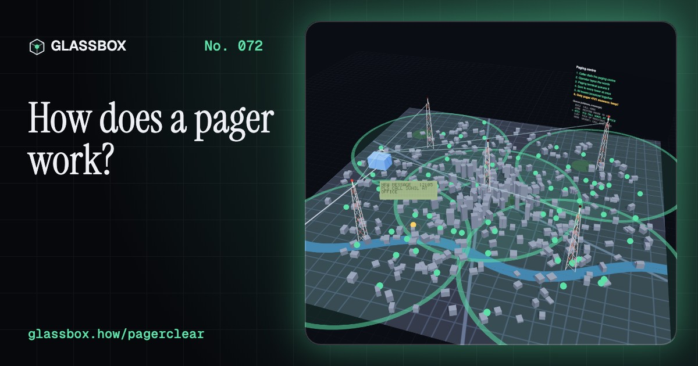
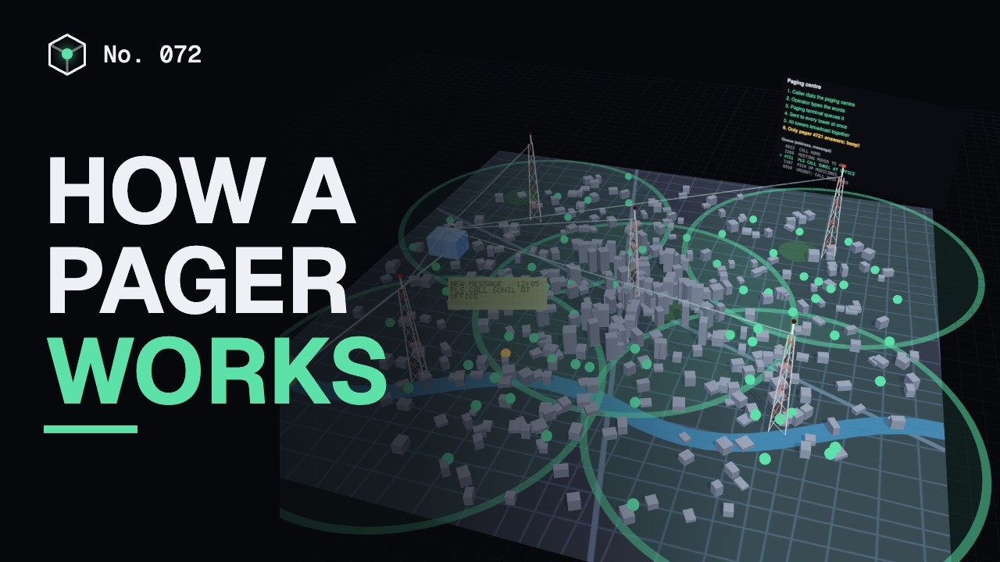
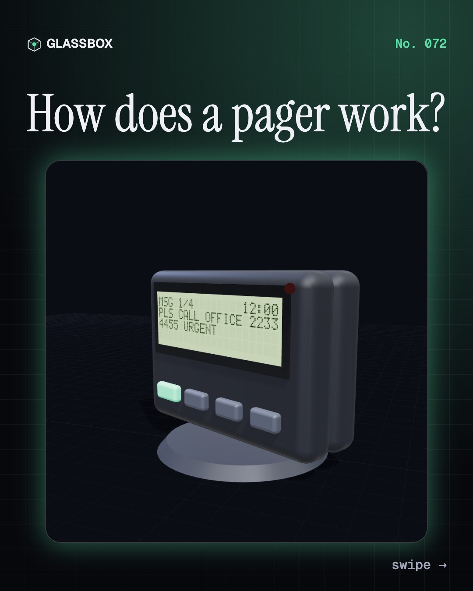
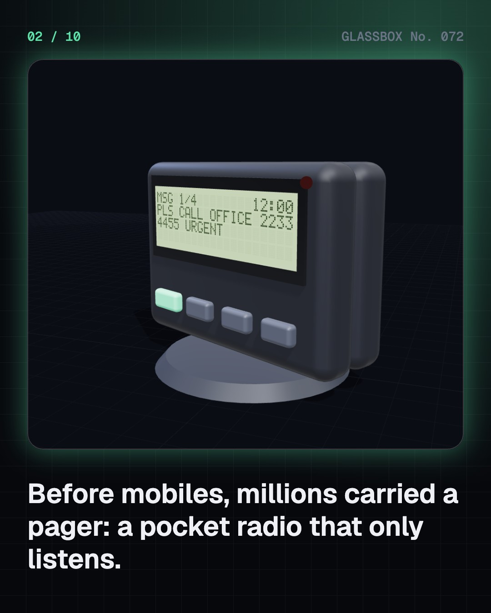
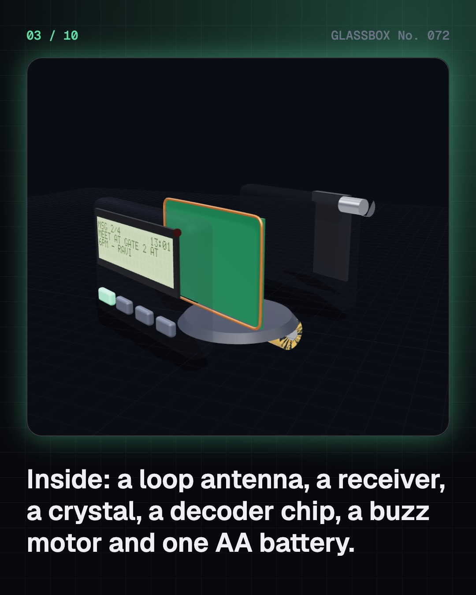
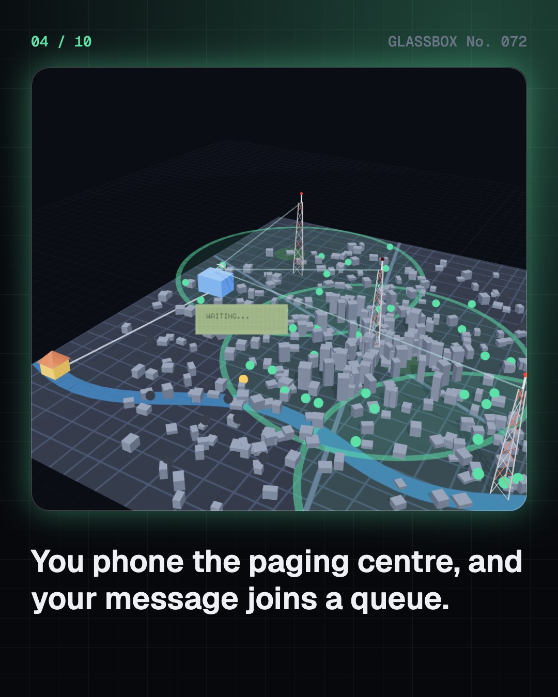

<!-- glassbox:start -->
<!-- Generated from glassbox.json by the Glassbox hub (npm run readme -- pagerclear). Edit glassbox.json, not this block. -->
<p align="center"><a href="https://glassbox-production-fd52.up.railway.app/e/pagerclear/"></a></p>

<h1 align="center">PagerClear</h1>

<p align="center"><b>How does a pager work?</b><br>Before mobiles, a beep on your belt meant someone needed you. Open a 1990s pager in 3D, type a message into a real POCSAG encoder, add radio noise and watch ten check bits repair it.</p>

<p align="center"><a href="https://glassbox-production-fd52.up.railway.app/pagerclear/"><b>▶ Play with it</b></a> &nbsp;·&nbsp; <a href="https://glassbox-production-fd52.up.railway.app/e/pagerclear/">Read the 60-second explainer</a> &nbsp;·&nbsp; <a href="https://glassbox-production-fd52.up.railway.app/pagerclear/glassbox/reel.mp4">Watch the 40-second video</a></p>

<p align="center">
  <a href="https://glassbox-production-fd52.up.railway.app/e/pagerclear/"></a>
  <a href="https://glassbox-production-fd52.up.railway.app/e/pagerclear/"></a>
  <a href="LICENSE"></a>
  <a href="LICENSE-CONTENT.md"></a>
  <a href="#privacy"></a>
</p>

## In 60 seconds

1. **A radio that only listens.** A pager is a pocket receiver with a loop antenna, a crystal-tuned receiver, a decoder chip, a small LCD, a buzz motor and one AA battery. It can't transmit, so it can't reply: it just waits for messages with its own address.
2. **One call, a whole city.** You phoned a paging centre and an operator typed your words, or the centre read your keypad tones. The message was queued, coded and sent from several tall towers at the same instant (simulcast). Every pager hears every page; only the one with the matching address beeps.
3. **Words become codewords.** In the POCSAG code each character is a 7-bit number, and bits are packed into 32-bit codewords: a flag, 20 message bits, 10 BCH check bits and a parity bit. After a 576-bit preamble come batches of a sync word and 8 frames, sent at 512, 1,200 or 2,400 bit/s by shifting the carrier 4.5 kHz up for 0 and down for 1.
4. **Ten bits that fix mistakes.** Noise flips bits on the way. The pager re-computes the check bits, and the mismatch points to the wrong bits. POCSAG's BCH(31,21) code plus parity corrects up to 2 errors in each codeword and notices when there are more.
5. **Why pagers lasted.** A pager listens only for the sync word and its own frame, so its radio is off about 80% of the time, and it never transmits. That stretches one AA cell to weeks or months. Strong VHF signals reach deep into buildings, which is why many hospitals and emergency crews still carry them.
6. **India's short pager boom.** India auctioned paging licences for 27 cities in 1992 and services began in 1995. Pagers, over 95% alphanumeric, beat early mobiles that charged about ₹16.80 a minute even to receive. Subscribers peaked at around 8 lakh in 1998 by one count, then faded as mobiles and SMS got cheap.

## Words worth knowing

| Term | Meaning |
|---|---|
| **Pager** | A small one-way radio receiver that shows short messages sent to its own address. |
| **Simulcast** | Several transmitters sending the same signal at the same moment to cover a whole area. |
| **POCSAG** | The pager code standardised in 1981: 32-bit codewords, sent in batches of a sync word and 8 frames. |
| **Codeword** | 32 bits: 21 information bits, 10 BCH check bits and 1 parity bit. |
| **Address (RIC)** | A pager's own 21-bit number; its last 3 bits choose which of 8 frames it listens in. |
| **FSK** | Frequency shift keying: sending 0s and 1s by nudging the radio frequency up or down. |
| **BCH code** | An error-correcting code; POCSAG's BCH(31,21) with parity fixes up to 2 wrong bits per codeword. |
| **Duty cycle** | The fraction of time a part is switched on; a pager's receiver is on about a fifth of the time. |

## A short history

**70 years from a doctor's radio bleep to India's pager boom, and the hospitals that still carry one.**

- **1949** · The first telephone pager (Al Gross, United States)
- **1956** · The first hospital radio 'bleep' (Multitone Electric Company, St Thomas' Hospital, London)
- **1964** · Pageboy I, the first consumer pager (Motorola, United States)
- **1981** · POCSAG becomes a world standard (CCIR (now ITU-R), Geneva)
- **1994** · 61 million pagers (Pager users worldwide, Worldwide)
- **1995** · Paging begins in India (Licensed paging operators, Indian cities)
- **1998** · India's pager peak (Indian paging operators, Indian cities)
- **2002** · India's pagers fade (Indian paging operators, India)

The full story, with 26 moments, charts, people and 24 sources: [glassbox.how/e/pagerclear/history](https://glassbox-production-fd52.up.railway.app/e/pagerclear/history/). The data lives in [`history.json`](history.json).

## Video and slides

Made with the Glassbox studio from this box's storyboard (`window.glassbox.director`). Free to reuse under CC BY 4.0.

<a href="https://glassbox-production-fd52.up.railway.app/pagerclear/glassbox/video.mp4"></a>

<p><a href="glassbox/slide-1.jpg"></a> <a href="glassbox/slide-2.jpg"></a> <a href="glassbox/slide-3.jpg"></a> <a href="glassbox/slide-4.jpg"></a></p>

| File | What | Size |
|---|---|---|
| [`glassbox/reel.mp4`](https://glassbox-production-fd52.up.railway.app/pagerclear/glassbox/reel.mp4) | Reel / Short, with captions and soundtrack | 1080×1920 |
| [`glassbox/video.mp4`](https://glassbox-production-fd52.up.railway.app/pagerclear/glassbox/video.mp4) | YouTube video, with captions and soundtrack | 1920×1080 |
| `glassbox/slide-1…10.jpg` | Instagram carousel | 1080×1350 |
| `glassbox/thumb.jpg` | YouTube thumbnail | 1280×720 |
| `glassbox/cover.jpg` | Share card and repo social preview | 1200×630 |
| [`glassbox/history-reel.mp4`](https://glassbox-production-fd52.up.railway.app/pagerclear/glassbox/history-reel.mp4) | “History in 10 moments” Reel / Short | 1080×1920 |
| `glassbox/history-slide-*.jpg` | History carousel | 1080×1350 |
| `glassbox/post.json` | Post copy and schedule used by the publish kit | |

## Privacy

This box has no accounts and no ads, and it ships its own fonts and libraries. When you run it yourself it sends nothing anywhere. On glassbox.how, the site's `/bar.js` also loads Glassbox's analytics: **Google Analytics** to count visits (it asks first in the EU, UK and Switzerland, and stays off when your browser sends Global Privacy Control or Do Not Track) and **ClickTrust** to detect bots.

It remembers a few things **in your own browser only**, and never sends them anywhere:

| Browser storage key | What it holds |
|---|---|
| `pagerclear.v1` | Which chapters you have opened, your best quiz scores, and sound on or off. |

Exactly what each one sees is at [glassbox.how/privacy](https://glassbox-production-fd52.up.railway.app/privacy/).

## Licences

- **Code:** [MIT](LICENSE). Use it, change it, ship it.
- **Explanations, text, images and videos** (`glassbox.json`, `glassbox/`): [CC BY 4.0](LICENSE-CONTENT.md). Credit “Glassbox, glassbox.how/e/pagerclear”.
- **Third-party parts** keep their own licences: [three.js](https://threejs.org) (MIT), [Geist, Instrument Serif](https://openfontlicense.org) (SIL OFL 1.1).
- The Glassbox name and logo aren't covered by either licence. See the [terms](https://glassbox-production-fd52.up.railway.app/terms/).

Found a mistake? [Open an issue](https://github.com/bdeeps/pagerclear/issues). Corrections happen in public.
<!-- glassbox:end -->

## Run it

It's plain HTML, CSS and JavaScript. No build step and no dependencies. Run locally, it contacts no other website.

```bash
python3 -m http.server 8000
```

Three.js and the fonts ship in `vendor/` and `fonts/`, so it also works offline.

Then open http://localhost:8000.

## How it's built

| File | What |
|---|---|
| `index.html`, `css/app.css` | The page and its styles |
| `js/app.js`, `js/stage.js`, `js/ui.js`, `js/kit.js` | The shared Glassbox 3D engine: chapters, 3D stage, controls, quiz, video director |
| `js/pager.js` | PagerClear's shared models and numbers: a real POCSAG encoder and BCH(31,21) decoder, the 5×7 LCD font, the 3D pager and tower, Hata coverage and battery maths |
| `js/chapters/*.js` | One file per chapter: the 3D model, controls, text, key terms, quiz and video scenes |
| `glassbox.json` | Title, question, explainer beats, key terms, browser storage and credits shown on glassbox.how |
| `reel` in each chapter | The storyboard the Glassbox studio records into short videos |
| `glassbox/` | The published video, slides, thumbnail and post copy |
| `fonts/`, `vendor/three/` | Self-hosted Geist and Instrument Serif (SIL OFL 1.1) and three.js (MIT) |
